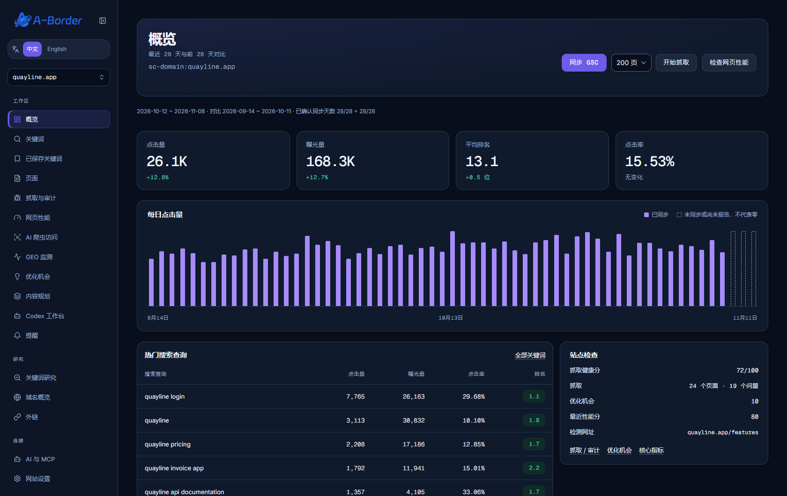
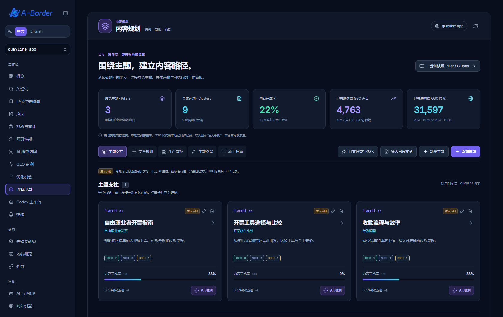

# A-Border SEO

自用的 SEO 与 GEO 工作台，基于 [CrawlSEO](https://github.com/crawlseo/crawlseo) 扩展。

本仓库保存 2026-11-11 本地部署的源码快照，应用版本为 `1.1.2`，包含后续的 ChatGPT 连接修复、Manus 关键词研究与结果预览。用于私有备份、继续开发和在新环境部署。

## 图片演示与操作案例

**[查看完整图文教程](docs/DEMO.zh-CN.md)** · [Windows 安装与启动](windows/README.md)

通过一个虚构的发票管理软件站点，演示「查看搜索表现 → 筛选关键词 → 检查页面问题 → 规划内容 → 审阅草稿 → 观察 GEO 数据」的完整流程。

> 以下为软件真实界面截图，使用隔离环境的模拟数据。图片中的流量、排名、研究结果和文章仅用于教学，不是真实客户数据或效果证明。制作演示未执行付费 API 调用。





| 想了解什么 | 图文入口 |
|---|---|
| 同步数据、筛选关键词、阅读审计问题 | [使用教程第 1 至 3 步](docs/DEMO.zh-CN.md) |
| Pillar / Cluster 与 TOFU / MOFU / BOFU | [内容规划案例](docs/DEMO.zh-CN.md#content-planning) |
| 草稿审阅、Manus 候选词筛选、GEO 数据 | [使用教程第 5 至 7 步](docs/DEMO.zh-CN.md) |

## 包含的功能

- Google Search Console 数据同步、站点抓取、SEO 审计和页面性能检查。
- 中英文界面、A-Border 品牌、Pillar / Cluster 内容规划与 TOFU / MOFU / BOFU 分类。
- AI 关键词建议、内容简报、文章草稿和修复建议，结果供人工审阅。
- ChatGPT 账号连接、本机 Codex worker 和只读 MCP。
- Manus 关键词研究、报告与 Excel 候选词预览、筛选及保存。
- GEO 监测、GA4 引荐流量同步及数据导入。

各项外部服务需要自己的授权及配置；源码不附带任何已登录账号、套餐额度或 API 密钥。第三方服务的可用性和计费以对应账号为准。

## 目录

| 位置 | 用途 |
|---|---|
| `source/` | Next.js 应用、后台 worker、数据库迁移、MCP、本机 worker 和测试 |
| `windows/` | Windows 启动脚本、Docker Compose、本机配置模板和使用说明 |
| `docs/` | 图文演示、使用案例及界面截图 |
| `升级说明.md` | 升级及数据迁移说明 |
| `LICENSE` | MIT 许可证，保留 CrawlSEO 与 A-Border 的版权声明 |

## 在 Windows 本机运行

1. 安装 Docker Desktop 并启用 Linux 容器，准备 PowerShell 7。
2. 下载或克隆仓库，保持 `source` 与 `windows` 为相邻目录。
3. 双击 `windows/构建镜像.cmd`。
4. 双击 `windows/配置Google.cmd`，在本机填写 Google OAuth 客户端信息并完成首次启动。
5. 浏览器访问 `http://localhost:3300`。

日常启动使用 `windows/启动服务.cmd`，停止使用 `windows/停止服务.cmd`。完整步骤见 [Windows 使用说明](windows/README.md)。已有部署请先阅读 [升级说明](升级说明.md) 并备份数据。

## Docker / 服务器部署

在 `source` 目录按 [应用部署说明](source/README.md) 配置自己的 `.env`，再运行：

```bash
cd source
cp .env.example .env
# 编辑 .env，填写本实例的数据库密码、应用密钥、Google OAuth 等配置。
docker compose up -d --build
```

Google OAuth 回调、HTTPS、ChatGPT 连接和本机 worker 都需要按实际部署环境配置。上传源码不会迁移本机数据库或授权状态。

## 开发与验证

```bash
cd source
npm ci
npx prisma generate
npx tsc --noEmit
npm test -- --pool=forks --maxWorkers=2
```

见 [开发说明](source/DEVELOPMENT.md) 与 [测试说明](source/TESTING.md)。原有 GitHub Actions 模板保存在 `source/.github/workflows/`，此目录结构下不会自动运行或发布镜像。

## 本地数据与密钥

仓库包含源码和配置示例。实际 `.env`、Google/ChatGPT 登录凭证、Manus 等 API 密钥、站点数据库、报表及备份留在原部署电脑上。

在新电脑上使用时，请重新配置所需授权，或按升级说明单独迁移私密数据。不要把数据库备份或真实 `.env` 加入 Git。

## 许可证

[MIT](LICENSE)。上游 CrawlSEO 与本项目的版权声明均已保留，源码中的各模块许可证同样保留。
