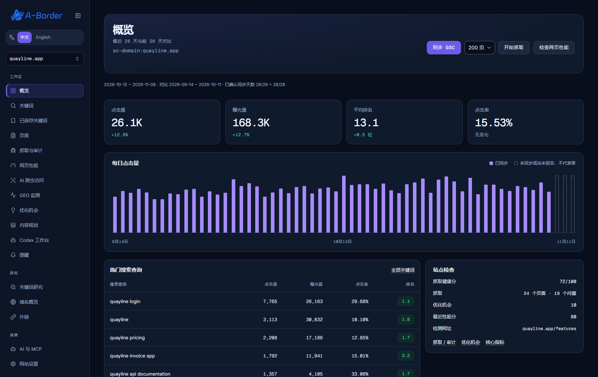
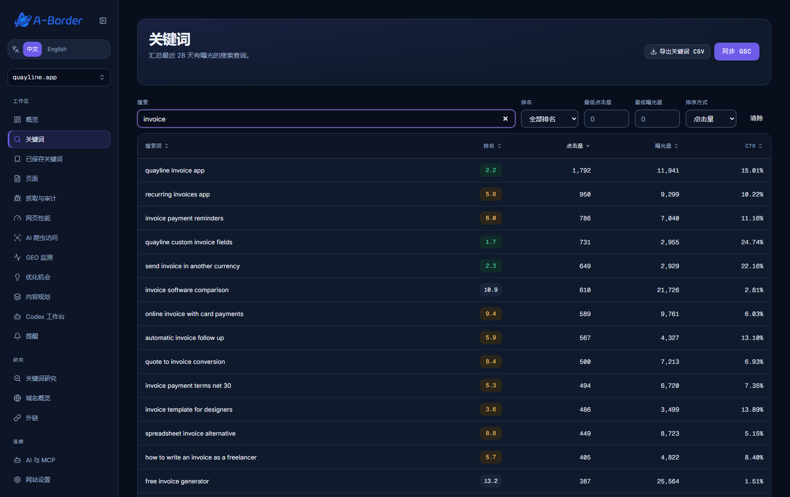
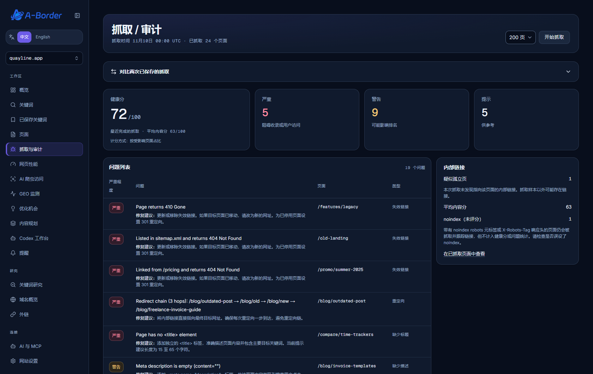
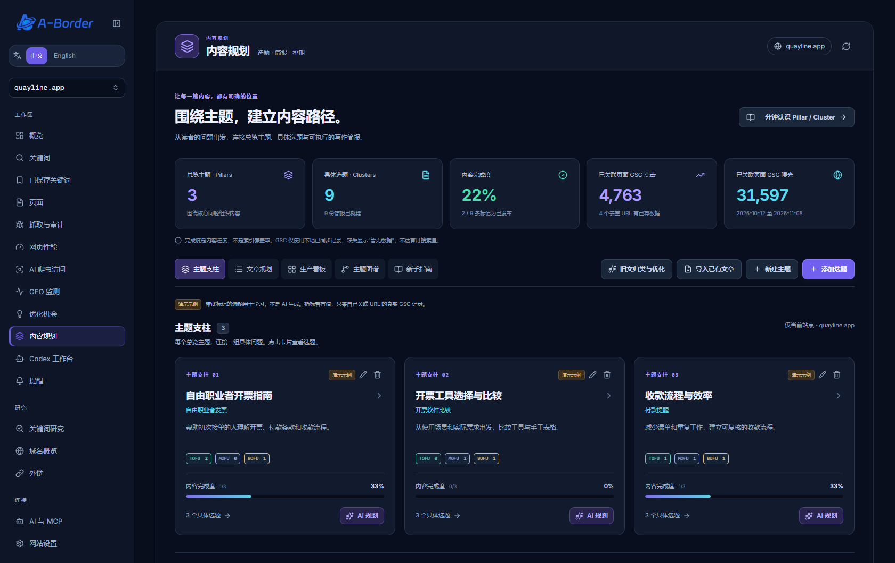
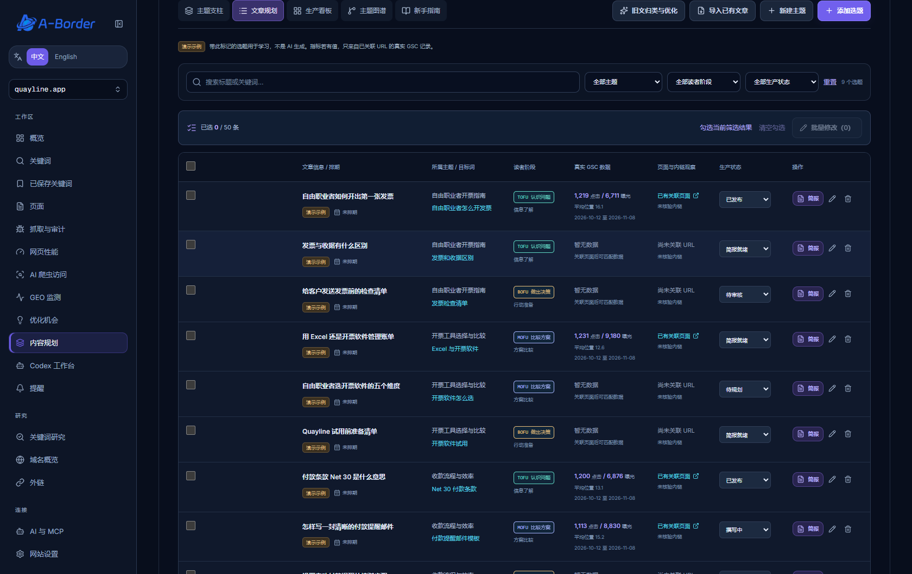
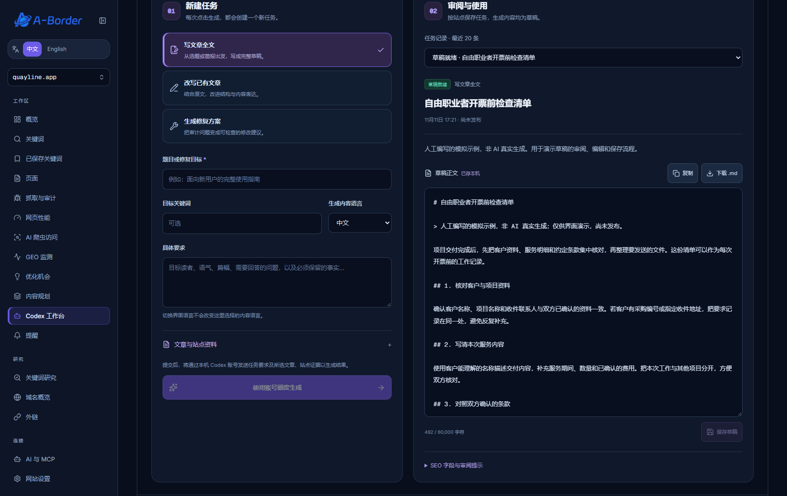
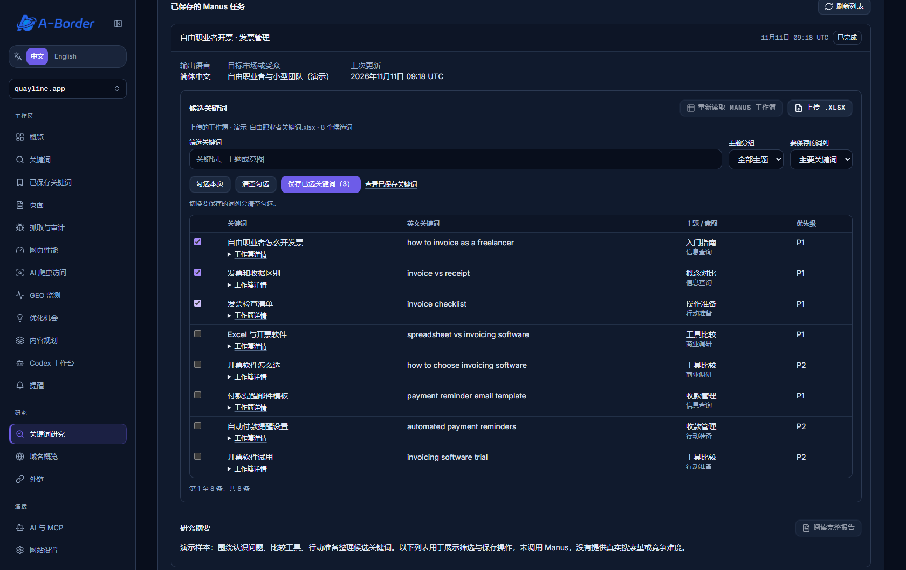
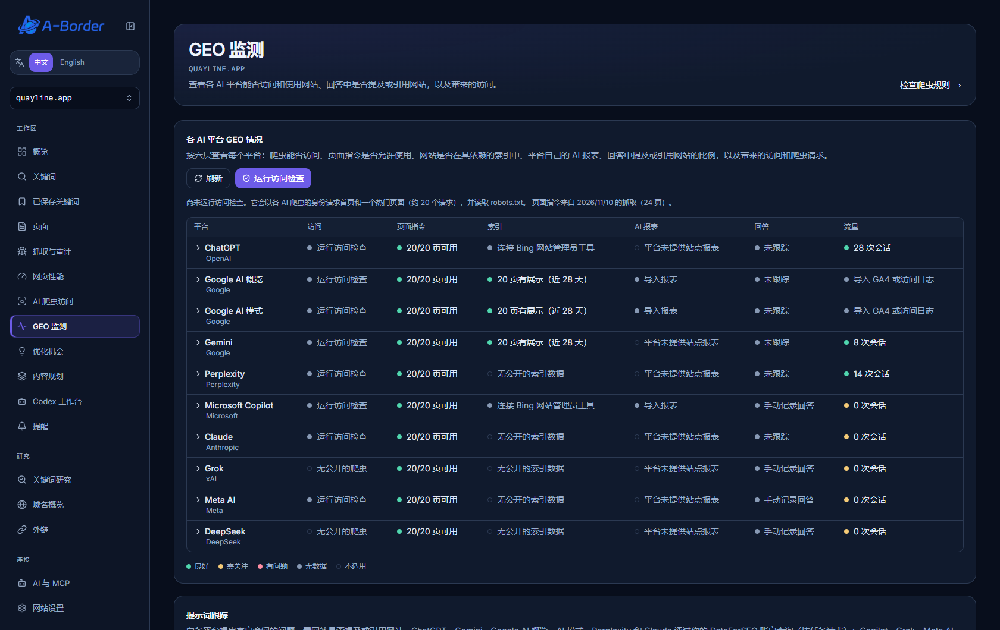

# 图文演示与操作案例

下面用一个虚构的发票管理软件品牌 **Quayline**，演示如何把搜索表现、网站问题和内容选题连接起来。假设它服务于自由职业者和小团队，准备围绕「发票管理」建设内容。

> 本页截图来自应用实际界面，使用隔离演示环境中的模拟数据。品牌、网站、关键词指标、研究报告、草稿和 GEO 记录均用于说明操作，不是真实客户数据、真实搜索量或 SEO 效果证明。制作演示未连接真实站点授权，也未执行付费研究或生成任务。

已有部署可直接跟着下面操作；首次安装请先看 [Windows 使用说明](../windows/README.md)。实际使用时，各项同步和 AI 功能需要你自己的相应授权。

截图版本：A-Border SEO `1.1.2`，拍摄日期：2026-11-11。点击图片可查看原尺寸。

## 1. 进入站点，先同步，再抓取

1. 登录后点击「添加网站」，选择你有权限管理的 GSC 资源，再点击「连接网站」。进入站点后的首页是「概览」。
2. 点击「同步 GSC」，等待结果提示。它读取 Search Console 中的关键词、页面及搜索表现；概览显示最近 28 天与前 28 天的对比。
3. 选择抓取页数，点击「开始抓取」。抓取用于检查页面本身，与 GSC 同步是两项任务。
4. 查看「站点检查」中的抓取状态和问题数量，再进入「抓取 / 审计」。

**看图关注：** 先看数据期间和趋势，再看热门关键词及站点检查。没有同步记录时出现空状态是正常的。GSC 可能返回页面数据但没有查询词，不能把空白理解为没有任何访问。

**Quayline 案例：** 想知道用户是否已经在搜索「invoice management」，先用 GSC 查询记录确认现有表现；想知道对应指南是否缺标题、缺 H1 或链接失效，则运行抓取。

## 2. 从已有查询中选出值得处理的词

1. 打开「关键词」，在「按搜索词筛选…」中输入业务词，例如 `invoice`。
2. 结合排名、最低点击量、最低曝光量和排序筛选。优先检查与产品相关、已有曝光但页面尚未充分回答的问题。
3. 进入「已保存关键词」，点击「保存关键词」，填写选中的词，并在备注里记录读者需求和拟对应页面。
4. 到「内容规划」建立主题和选题。已保存关键词是研究清单，保存一个词不会自动创建文章。

**看图关注：** 点击、曝光、CTR 和平均排名是站点在所选期间的 GSC 表现，不是整个市场的月搜索量。尚无 GSC 记录的候选词可以保存，表现字段可能显示「暂无」。

**示例备注：** `invoice management` 对应总览指南；`invoice software vs spreadsheet` 对应方案对比。先确认是否已有相关页面，避免为同一个问题重复建文。

## 3. 用审计结果确定修改顺序

1. 打开「抓取 / 审计」，确认最近完成的抓取时间与抓取页数。
2. 查看「严重」「警告」「提示」及「问题列表」，按具体 URL 阅读问题与修复建议。
3. 在网站后台修改受影响页面，例如补全正确的标题、修复失效链接、核对不应出现的 `noindex`。
4. 修改后重新抓取，查看新结果；涉及搜索表现的变化，再同步 GSC 持续观察。

**看图关注：** 健康分描述本次抓取样本。达到页数上限时，样本之外的页面不在结论范围内。「疑似孤立页」表示本次样本没找到指向它的内链，需要结合实际导航复核。

**Quayline 案例：** 若指南链接到了已经删除的模板页，先修复这个链接，再为指南补充内容。修复记录和重新抓取能帮助检查实施情况，分数变化本身不能证明排名增长。

## 4. 建立 Pillar / Cluster，把选词变成写作简报

切换到「文章规划」，可在同一张表中查看选题所属主题、漏斗阶段和生产状态：

Pillar 是覆盖一个大问题的总览主题；Cluster 是围绕它展开、各自回答一个具体问题的选题。TOFU、MOFU、BOFU 则描述读者离决策有多近。

| 规划位置 | Quayline 示例 | 内容要解决的问题 |
|---|---|---|
| Pillar 总览主题 | 自由职业者开票指南 | 从创建、发送到跟踪，介绍完整流程并连接详细文章 |
| TOFU · 认识问题 | 自由职业者如何开出第一张发票 | 帮助首次开票的读者了解基本信息与流程 |
| MOFU · 比较方案 | 用 Excel 还是开票软件管理账单 | 帮助读者比较表格与软件的工作方式及取舍 |
| BOFU · 做出决策 | 给客户发送发票前的检查清单 | 帮助即将发送发票的读者逐项核对内容 |

演示还包含「开票工具选择与比较」「收款流程与效率」两个主题，共 3 个主题、9 个选题。表中是编辑示例，不代表这些词已被验证有搜索需求；实际发布前需核实文章中的事实与操作步骤。

1. 打开「内容规划」，点击「新建主题」。填写总览主题名称、核心关键词、主题说明、目标读者和内容目标，再点击「保存主题」。已有总览页时，可以关联本站 URL。
2. 点击「添加选题」，填写目标关键词、读者阶段、搜索意图和内容形式。展开「手动补充内容简报」，补充大纲、要点、行动引导、站内链接及「依据与待核实项」，点击「保存选题」。
3. 如需 AI 协助，在主题卡片点击「AI 规划」，设置「本次建议数量」和「分配方式」。可以均衡覆盖、认知优先、决策优先或自定义，三个阶段数量之和须等于总数。
4. 确认输入后点击「生成选题与简报」。任务使用 ChatGPT 账号额度；生成结果先留在候选区。
5. 对候选项逐个「展开内容简报」，检查重复选题、目标读者和事实依据。勾选需要的项，再点击「确认采纳 N 个选题」。默认跳过已有同关键词选题；需要更新旧简报时，明确勾选对应选项。
6. 在「文章规划」筛选和编辑选题，在「生产看板」记录待规划、简报就绪、撰写中、待审核、已发布等工作进度。

**看图关注：** 主题卡片回答「内容属于哪个大问题」，读者阶段回答「这篇文章服务于谁」。内容完成度是本地工作进度；主题图谱显示规划关系，不等于网站已经存在这些内链。

## 5. 从简报写成草稿，再人工审阅

截图中的《自由职业者开票前检查清单》是人工准备的演示草稿，非 AI 生成结果，用于展示正文编辑、保存与审阅界面。

内容规划中的「AI 规划」生成选题与简报。需要文章全文时，进入站点的「Codex 工作台」。

1. 选择任务类型「写文章全文」，填写题目、目标关键词、生成内容语言及具体要求。
2. 在「已有选题或简报」中选择刚才的条目；需要补充依据时，选择已抓取页面或粘贴资料。只在要求里写一个网址，不会自动抓取该网址。
3. 确认所选生成方式已连接；使用本机 Codex 时，还需要本机助手在线。检查账号用量设置后，点击「使用账号额度生成」。
4. 在「审阅与使用」打开任务，编辑「草稿正文」。同时检查「SEO 字段与审阅提示」中的待核实信息、修改建议和内链建议。
5. 点击「保存草稿」，再按需「复制」或「下载 .md」。核实后到网站后台发布，并在内容规划中填写实际页面 URL、更新工作状态。

**Quayline 审稿示例：** 阅读《自由职业者开票前检查清单》，检查是否把收件人、项目明细、金额和付款说明写清楚；涉及不同地区要求的说法应保留为待核实项。对软件与表格的对比稿，另行核实产品功能、价格和用户评价。保存草稿和标记「已发布」都只是本地记录，不会替你发布网站。

已有文章可以使用「内容规划」中的「旧文归类与优化」：一次选择最多 5 篇，必要时补充正文，运行复核后审阅保留、补充、修改与内链建议，再「采纳所选归类与更新简报」。采纳只保存本地任务，网站正文需要自行修改，完成后重新抓取核验。

## 6. Manus：先看报告和候选词，再选择保存

1. 打开「关键词研究」，切换到「Manus 深度研究」。实际发起研究前，在设置中连接自己的 Manus API 密钥。
2. 输入种子关键词、目标市场或受众及输出语言。确认使用账号积分后，点击「开始 Manus 研究」。演示截图展示的是预置模拟任务，没有执行这一步的付费请求。
3. 在「已保存的 Manus 任务」查看状态，按需点击「从 Manus 更新结果」或「阅读完整报告」。需要补充信息或下载私有附件时，使用「打开 Manus 私有任务」。
4. 在「候选关键词」点击「读取任务关键词」。也可从该任务下载 Excel 后「上传 .xlsx」，文件上限为 5 MiB。
5. 按「筛选关键词」「主题分组」缩小范围；有双语列时，先选「要保存的词列」，再勾选需要的词或「勾选本页」。切换词列会清空勾选。
6. 展开「工作簿详情」，核对来源、证据状态和指标依据，再点击「保存已选关键词（N）」，通过「查看已保存关键词」确认结果。每次最多勾选 500 个，已有词会标记为已保存。

**看图关注：** 演示包含 8 个中英文对照候选词，样本未提供搜索量、难度和 CPC，不能据此推断市场规模。实际研究中的推荐理由、需求等级或预估竞争强度需要结合来源判断；把关键词保存到本站不会把报告中的估计变成真实 GSC 指标。

**Quayline 案例：** 以 `freelancer invoice` 和 `recurring invoice` 为种子，先检查候选词是否符合自由职业者的需求，再保存少量适用条目，手动纳入第 4 步的主题和选题。

## 7. GEO：分清访问、回答与流量的证据

打开「GEO 监测」，先看「各 AI 平台 GEO 情况」，再按需要向下查看提示词、平台报表、AI 访问数据和技术准备度。

| 页面区域 | 可以了解什么 | 阅读时要区分 |
|---|---|---|
| 各 AI 平台 GEO 情况 | 访问、页面指令、索引、AI 报表、回答和流量的证据状态 | 缺少数据不是零表现；访问检查也不能证明真实爬虫一定得到相同响应 |
| 提示词跟踪 | 保存问题，观察所收集回答是否提及品牌或引用网站 | 结果取决于平台、问题、时点和收集方式，不是平台对网站的统一排名 |
| 平台官方 AI 报表 | 导入相应平台导出的报表 | 必须有实际导出文件；演示里的模拟记录不构成官方证据 |
| AI 访问数据 | GA4 同步或 CSV 导入的 AI 引荐会话，以及导入日志中的爬虫请求 | 会话不等于所有 AI 曝光；日志 User-Agent 自称的爬虫身份仍需核验 |
| GEO 技术准备度 | 最近抓取样本中，适用检查项的通过比例 | 这是本地自查分数，不是 Google、OpenAI 等平台的官方 GEO 分数，也不预测引用或排名 |

**一个可执行的跟踪例子：** 在「提示词跟踪」添加「适合自由职业者管理周期性发票的软件有哪些？」。实际观察后，可在「手动记录回答」选择提示词，粘贴回答及来源链接，再「保存回答」。下次比较时尽量保持问题和观察条件一致，并打开回答详情检查引用。

自动查询通过 DataForSEO 按任务计费，界面会展示平台、预计任务数和预算，需确认后运行。本演示未调用付费查询；截图中的会话是模拟数据，没有收集回答的平台显示「未跟踪」或「手动记录回答」。

## 一次完整操作结束后，应留下什么

- 一组有来源、与业务相关的已保存关键词。
- 一个范围清楚的总览主题，以及分属不同读者阶段的具体选题。
- 经人工核实的大纲、写作简报和待审核草稿。
- 在网站后台实际实施的修改，以及更新后的抓取和搜索表现记录。
- 能追溯到具体回答、来源链接、报表或日志的 GEO 观察。

从一条关键词和一篇文章开始即可。先完成「同步与抓取 → 选词 → 主题与简报 → 草稿审阅 → 人工发布 → 再检查」这一轮，再逐步扩展内容规模。
